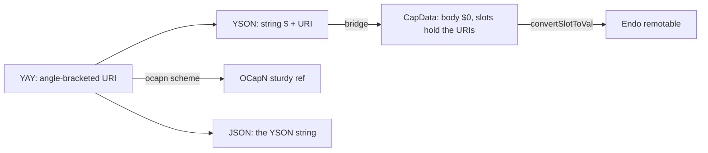

# References

Status: decided, 2026-11-03, for the 3.0.0 line, the second feature after
[tagged values](tagged-values.md). Proposed 2026-11-02 on option E's tags
(`af97e73` on `design-references`); rebased here onto option G, where a
tag is always in parentheses, with Kris's answers of 2026-11-03 folded in.
Nothing is open. Scheme constraints in YAY Schema (the old question 8) are
deferred until the dev editor's schema checking is built, and are not part
of 3.0.0. The prototype is in [references/](references/).

## Problem

A YAY document can say "this text" and "these bytes", but not "that thing
over there". A configuration that names an image, a peer, a package or
another document writes a string, `icon: "https://example.com/cat.png"`,
and leaves it to a convention outside the document that the string is a
designation and not prose. A schema cannot tell a URL from a title, a
diff cannot tell a moved link from an edited sentence, and a bridge to
Endo or OCapN cannot tell which strings should become references on the
other side.

Endo and OCapN have the missing kind. Endo's passable data has remotables
and promises beside copy data, and `@endo/marshal`'s smallcaps writes them
as strings beginning with `$` (a remotable) and `&` (a promise), each
naming a **slot**: an index into a list of identifiers that travels beside
the body (`$0.Alleged: Counter`, `&1`). OCapN names an object at rest
with a **sturdy ref**, an `ocapn://` URI.

Kris's prompt, 2026-11-02: reuse the angle brackets, holding a URL, since a
URL and inline bytes never overlap.

## Scope

In scope: the written form in YAY and MEH, the data model, equality, the
mappings (YSON and the CapData bridge, JSON, OCapN, SHON, each binyay
target, the dev data editor), and how references meet tags.

Not in scope: dereferencing. No YAY reader fetches, resolves or opens a
reference; a reference is a name, and what it names is the application's
business. Not in scope either: promises (Kris, 2026-11-03), live
capabilities and errors, which stay outside YAY. Nor scheme constraints in
YAY Schema: deferred until the dev editor's schema checking is built.

## 1. The written form

```yay
icon: <https://example.com/cat.png>
peer: <ocapn://a2ef69ddd5f8.tcp-testing-only?host=127.0.0.1&port=22046>
spec: <urn:ietf:rfc:3986>
page: <https://例え.jp/パス>
seed: <ff8800>
empty: <>
mirrors: [<https://a.example/x>, <https://b.example/x>]
thumb: <https://example.com/cat.png> (image/png)
```

**A scheme is required (R1, Kris, 2026-11-03).** Inline bytes are
lowercase hex pairs, with optional single spaces between pairs. A URI's
scheme is a letter followed by letters, digits, `+`, `-` or `.`, then a
colon (RFC 3986 § 3.1). The colon is never a hex digit, so after `<`:

- a `>` is the empty byte array, as today;
- a run of scheme characters followed by `:` is a reference;
- anything else is bytes, held to today's rules.

The reader scans `[A-Za-z][A-Za-z0-9+.-]*` and looks at the next
character; nothing reaches past it. The two refused bytes typos in the
corpus, `<deadbeefXX>` (`bytearray-inline-invalid-hex-digit`) and
`<DEADBEEF>` (`bytearray-invalid-uppercase-hex`), stay refused, as does a
scheme-less name (`<./a.yay>`, `<#frag>`). Relative references, if they
come later (R3: R1 plus a reference by its first character, `.`, `/`, `#`
or `?`), are relative to nothing in YAY: a reader keeps the text and may
offer the application the base it loaded the document from, and never
resolves it (Kris, 2026-11-03).

```
inline-reference = "<" scheme ":" { uri-char } ">" ;
scheme           = "a".."z" { "a".."z" | "0".."9" | "+" | "-" | "." } ;
uri-char         = unreserved | gen-delim | sub-delim | pct-encoded
                 | ucschar ;
unreserved       = ALPHA | DIGIT | "-" | "." | "_" | "~" ;
gen-delim        = ":" | "/" | "?" | "#" | "[" | "]" | "@" ;
sub-delim        = "!" | "$" | "&" | "'" | "(" | ")"
                 | "*" | "+" | "," | ";" | "=" ;
pct-encoded      = "%" HEXDIG HEXDIG ;
ucschar          = /* U+00A0 and above, not a control, space or
                      separator, nor U+FFFE, U+FFFF: RFC 3987 */ ;
```

`inline-reference` joins `inline-atom` in `GRAMMAR.md` § Inline Values,
beside `inline-bytes`, so it takes the inline `suffix` of tags as every
inline atom does.

- **IRIs** (Kris, 2026-11-03): non-ASCII characters are written as they
  are, since YAY is UTF-8 and meant to be read. Percent-encoding is still
  allowed and is kept as written.
- **Nothing is escaped.** A URI cannot hold a space, `<`, `>`, `"`, `{`,
  `}`, `|`, `\`, `^` or a backtick; RFC 3986 percent-encodes them, and the
  reader refuses them, naming the character. So `>` always closes a
  reference, and the text between the brackets is the URI, verbatim. A `%`
  begins a percent-encoding, two hex digits of either case.
- **The scheme is lowercase** in YAY, as hex is: `<HTTPS://x>` is refused
  with a message that names the scheme, not "invalid hex".
- **No space** after `<`, before `>` or inside; closed on its line.
- **The brackets shield their text.** `#` is not a comment inside them,
  and `,`, `]`, `}`, `(`, `)` and `'` are not syntax there, so a reference
  sits in inline arrays and objects as bytes do:
  `[<https://x/a,b]c?e=(f)>, 1]` is two items.
- **No block form.** `key: >` introduces block bytes, as today.
- **Not a key.** Keys stay strings: `<https://x>: 1` is refused.
- **A tag is a suffix, in parentheses**, one space after the `>`, as on
  any inline value (option G). `<https://x>rgb` and `<https://x>(rgb)` are
  refused in YAY, and a prefix tag on an inline reference is refused as on
  any inline value (`a: (t) <https://x>`).

**MEH** reads a reference as YAY does, with MEH's usual leniency: any run
of spaces, or none, before a tag (`<https://x>(t)`), and an uppercase
scheme, lowercased as MEH lowercases hex (`<HTTPS://x>` is
`<https://x>`). Text glued to the `>` other than a tag falls to MEH's bare
string, as `<ff>rgb` does today. One reading changes: MEH ends a line at
any `#` today, so it reads `a: <https://example.com/#frag>` as the string
`"<https://example.com/"`; under references the brackets shield the `#`,
and it is the reference. No document in `test/meh` holds such a line.
`yay -f meh -t yay` writes the YAY form, and `yay --check -t yay` flags an
uppercase scheme or a touching tag.

## 2. The model

A **reference** is its own kind, the tenth: a URI or IRI, held as the text
written.

- **Not a string.** `<https://x>` never equals `'https://x'`. A string is
  text to show; a reference is a designation to follow, and keeping them
  apart is what lets a bridge make remotables of the one and leave the
  other.
- **Not bytes.** The brackets are shared; the kind is not.
- **Equality by text** (Kris, 2026-11-03), code point for code point,
  within the kind, with no RFC 3986 § 6 normalization: `<https://x/>` and
  `<https://x>` differ, and `%2f` and `%2F` differ. A scheme's
  normalization belongs to the application. Hash the text with a kind
  marker no other kind uses.
- **Ordering**, where a port orders values: after tagged, by text.
- **A tagged reference is a tagged value** (Kris, 2026-11-03) whose
  payload is a reference, as `10 (s)` is one whose payload is an integer.
  A tag is not a reference's interface: `<ocapn://…> (Counter)` is the tag
  `Counter` over a reference, never smallcaps' alleged interface
  (`$0.Alleged: Counter`), since a persisted claim of interface would look
  like a fact, and the model would depend on the payload's kind.
- **No promises** (Kris, 2026-11-03). YAY writes names of objects at rest;
  a bridge that wants promises makes them in `convertSlotToVal`.

`GRAMMAR.md` § Data Model grows a tenth row:

| Type | Description |
|------|-------------|
| Reference | A URI or IRI, held as written; designates, never dereferenced |

## 3. Mappings



**YSON** (Kris, 2026-11-03) writes a reference as smallcaps writes a
remotable, a string beginning with `$`, with the URI in place of the slot:
`"$https://example.com/cat.png"`. A tagged reference is
`{"#tag": "image/png", "payload": "$https://…"}`. 3.0.0's YSON writer
already escapes a string beginning with any character from `!` to `/`
(`"!$5"`), so no string is written as a reference. Its reader reads
`"$x"` as the string `$x` today, which no writer produces; with references
`"$"` followed by a scheme and `:` is a reference, and `"$"` followed by
anything else is refused. `"&…"` is not written; the reader treats it as
it does today. This is a smallcaps *body* that names its slot by URI
instead of by index, which `@endo/marshal`'s decoder cannot read alone
(it reads `$` as `$index.iface`), so a bridge does.

**The CapData bridge**, in the JavaScript port beside its smallcaps test
(`js/libyay`, whose dev dependencies already have `@endo/marshal`): from
YSON to CapData, walk the body, move each distinct URI into `slots` in
order of first appearance and write `$0`, `$1`, … in its place; the
reverse puts each slot's text back. Then `makeMarshal(convertValToSlot,
convertSlotToVal)` does the rest, and the caller's `convertSlotToVal`
decides what a URI becomes: a remotable from an OCapN client, a far
reference to an HTTP service, or a refusal. YAY supplies the name; the
caller supplies the authority.

**OCapN.** An `ocapn:` reference is a sturdy ref
(`ocapn://<designator>.<transport>`, as Endo's OCapN client writes a
location, with the swiss number in the path per OCapN's Locators draft).
The bridge's caller parses it and calls the client's `makeSturdyRef`; the
application decides when to enliven it. OCapN's wire references never
appear in YAY.

**JSON** cannot hold a reference. `yay -t json` writes the YSON spelling,
`"$https://…"`, as it writes a tagged value's smallcaps object, and
`-f json` reads it back as a string, so the lossless round trip is YSON.
**YAML, TOML and CBOR** refuse a reference in 3.0.0, as they refuse a
tagged value. CBOR's tag 32 (a URI) is the natural mapping, but tag 32 is
ASCII and IRIs are not; it waits for CBOR's tagged-value mapping.

**SHON** gains `-r`, which takes the next token as a reference:
`yay [ --icon -r https://example.com/cat.png ]`. The token must have a
scheme; `-r` refuses one without. A bare token is never a reference.
`-T image/png -r https://x` is a tagged reference.

**binyay's outputs.** Each target gains a reference type:

| Target | Reference as |
|---|---|
| `js` | a frozen `{reference: "…"}` from a small `reference(uri)` helper, beside `tagged`; not a `URL`, which normalizes |
| `go` | `yay.Reference`, a type of its own made only by `NewReference(uri)` or `MustReference(uri)`, which refuse text that is not a reference's |
| `python` | a frozen dataclass `Reference(uri: str)`, beside `Tagged`; not a `str` subclass, which would equal the string |
| `rust` | `Value::Reference(Reference)`, a `Reference` made only by `Reference::new(uri)` or `Value::reference(uri)`, which refuse text that is not a reference's |
| `c` | `YAY_REFERENCE`, with the text in the value union |
| `java` | `record Reference(String uri)` |
| `scheme` | a record type `reference` with `reference-uri` |
| `md`, `yd` | front matter holds references as YAY does |

**The dev data editor** (dev.kriskowal.com's `lib/yay/model.js`) gains a
tenth kind, `reference` (Kris, 2026-11-03): a `YayReference` holding the
text, read and written by `read.js`, `write.js`, `json.js` and
`yson.js`, shown as a link-styled chip whose text edits in place. It does
not follow the link on click and fetches nothing to preview it: an editor
that dereferences what it displays tells a stranger's server who opened
the file. Opening it is an explicit command.

**YAY Schema.** How a pattern admits a reference and constrains its
scheme is deferred until the dev editor's schema checking is built.

## Test plan

- The prototype ([references/](references/): `desugar.py` rewrites each
  reference into a string under a tag no document uses, and `check.py`
  reads the result with the unmodified Python port and binyay 3.0.0 at
  `9380d90`, as YAY and as MEH). Run 2026-11-03: all 170 `test/yay` and
  61 `test/meh` documents unchanged, the tagged corpus among them; none
  of the 121 `test/nay` documents made valid, under any reader, the two
  bytes typos included; 31 new cases (15 accepted as YAY and MEH, 2 as
  MEH only, 14 refused by both), 99 checks, no failures. 3.0.0 refuses
  every positive case without references, but for one control
  (`unchanged-in-strings`, bracketed text in strings, a tag and a block
  string, which must not change) and MEH's reading of `then-comment`
  (§ 1, MEH).
- The build moves the cases into `test/yay`, `test/meh` and `test/nay`
  with each port's expected value, adds `.yson` for each, and adds
  `bytearray-inline-invalid-space-after-open.nay` (`a: < ff>`): the Python
  port accepts it today, and raises `NameError: block_mode` on
  `a: < https://x>` and `a: <1a:b>` (lexer.py, `read_bytes`), which the
  prototype met.
  Done; once every case was in the corpus, `references/cases/` was
  removed, and the prototype runs from the design's commit
  ([references/README.md](references/README.md)).
- Round trips: YAY → YSON → YAY; YSON → CapData → YSON with a repeated URI
  sharing one slot; YAY → JSON gives `"$uri"`, read back as a string.
- An Endo test beside `smallcaps.test.js`: marshal a document with an
  `ocapn:` reference through `makeMarshal` and a `convertSlotToVal` that
  records each URI; a tagged reference decodes as `makeTagged` over the
  remotable.
- SHON: `-r https://x`, `-T t -r https://x`, `-r` with no scheme refused.
- The dev editor: a reference survives read, edit of its text, and write;
  opening a document makes no network request.

## Rollout

In 3.0.0, after tagged values, so YSON breaks once (Kris, 2026-11-03).
On `tower/tagged-values`: `GRAMMAR.md`, the spec and the corpus; each
port's reader, and the writers where a port writes (Rust and Python);
YSON and the bridge (Rust's codec, the JavaScript bridge); SHON's `-r`;
binyay's targets; the CHANGELOG and the 3.0.0 notes, references as the
second feature. The dev editor's tenth kind follows in dev.kriskowal.com.

## Alternatives

- Considered and rejected: R2, a reference whenever a non-hex character
  appears. Reason: the two refused bytes typos would become quiet
  references.
- Considered and rejected: a reference as a conventional tag over a string,
  `'https://x' (ref)`. Reason: a reference would be a string to every
  reader that does not know the tag, and the Endo mapping a special case.
- Considered and rejected: a sigil, `@"https://x"`. Reason: tags rejected
  sigils, and the angle brackets exist.
- Considered and rejected: slots in the document, `<0>` with a table
  elsewhere. Reason: that is CapData's wire shape, and `<0>` is bytes.
- Considered and rejected: YSON as CapData, `{body, slots}`. Reason: it
  changes every YSON document's shape.

## Open questions

None. Decided 2026-11-03, for the record: references in 3.0.0 after tags;
R1; IRIs; relative references, if they come, relative to nothing; equality
by text; YSON `"$uri"` with the CapData bridge; no promises; a tagged
reference is a tagged value; the dev editor's tenth kind with no
dereferencing. Scheme constraints in YAY Schema are deferred. Three
consequences the designer drew, which Kris may overturn without cost to
the rest: MEH lowercases an uppercase scheme; YAML, TOML and CBOR refuse a
reference until CBOR maps tags; and YSON's reader refuses `"$"` without a
scheme.
